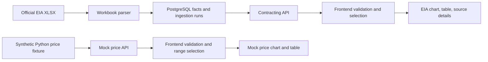

# Milestone 10 — Local verification and handoff

Reviewed November 16, 2026. The agreed **mock-price/EIA workshop application**
passed the local handoff checks. The original Phase 1 requirement for real
Cameco historical prices remains unmet: permission is unresolved, and the price
API/chart remain synthetic. Completing the ten workshop milestones does not
make that original requirement complete.

## Verification environment and results

The review started from tracked revision `03d3fab`, exported into
`/tmp/uranium-m10-q9dy_3wg` without `.git`, `.env`, dependencies, raw downloads,
processed data, or existing database state. The small frontend correction below
was copied into that clean checkout and its affected checks rerun.

Compose project `uranium-m10-q9dy-3wg` used its own new PostgreSQL volume and a
private generated test password passed through process environment. No existing
project volume or `.env` was changed. Docker Desktop/WSL integration was enabled
before container checks. Observed tooling: uv 0.12.2, Node 24 locally, Docker
24.0.6, Compose v2.23.0. PostgreSQL reported 18.7; API image Python was 3.13.18.

| Check | Result |
| --- | --- |
| Fresh `uv sync --locked --extra examples` and `npm ci` | Passed with existing lockfiles; npm reported zero vulnerabilities |
| Compose configuration, image builds, all three services | Passed from clean runtime state |
| Clean database migration | `0001_provenance (head)`; repeated upgrade unchanged |
| Fresh database before source import | Typed EIA unavailable/empty response; no mock EIA substitution |
| Official EIA workbook download and preview | Tables 7/8/9/10 parsed as 24/9/22/66 observations |
| First EIA import | 121 observations added |
| Repeated EIA import | Zero added/revised; 121 unchanged, separate run records |
| Backend, parser, PostgreSQL, migration, example tests | **94 passed, zero skipped**; known HTTPX deprecation warning |
| Frontend component/data-contract tests | **10 passed** after the review correction |
| Chromium desktop/mobile tests | **8 passed** at 1280px and 375px after the correction |
| TypeScript/production build | Passed; existing 794 kB JS chunk warning (263 kB gzip) |
| Live Compose browser review | All four EIA views, mock-price card, provenance, health button, no page errors/document overflow |
| Exact EIA source/database/API/UI match | Table 8 total count and raw artifact checksum matched throughout |
| Compose down/up persistence | Imported count remained 22; normal database reuse confirmed in logs |
| DuckDB/Parquet example | Six typed rows written/read from clean checkout; API parity included in tests |
| Actual WebSocket client/network exercise | Four checks passed: receipt, manual disconnect, server-stop retry, reconnect/new sequence |
| Source-file audit | No tracked raw downloads, processed snapshots, or `.env`; EIA fixture hashes/attribution matched |

The Docker browser tests ran with the host UID/GID so caches and test outputs
remain writable by local npm. The WebSocket exercise used the actual HTML/JS in
jsdom over real local frames; it was not a Chromium visual test of that separate
educational page. Main-dashboard visual/browser checks used Chromium.

### Small fixes found during review

1. **Suppressed components versus totals:** Table 10 may withhold all annual
   supplier quantities while publishing aggregate horizon totals. The chart
   notice now says *all plotted component values* are withheld/missing, rather
   than incorrectly saying all selected values are unavailable. Tests include
   available U.S.-supplier totals of 1,317/1,548 alongside withheld components.
2. **Startup documentation:** the main Compose quickstart now applies migrations,
   retries the liveness request during startup, and explains that EIA import is
   a separate step. Existing-volume passwords and API-root 404 behavior are
   clarified. No dependency versions or database schema changed in this review.

## Commands to reproduce

Run from the normal repository root. For existing database volumes, supply the
original database password. Creating an environment variable does not change a
password stored in an existing volume.

```bash
uv sync --directory backend --locked --extra examples
npm --prefix frontend ci

read -rsp 'Local database password: ' POSTGRES_PASSWORD
export POSTGRES_PASSWORD
printf '\n'
docker compose config --quiet
docker compose up --build -d
docker compose exec api uv run --locked --no-dev alembic upgrade head
docker compose exec api uv run --locked --no-dev alembic current
curl --fail --retry 10 --retry-connrefused --retry-delay 1 http://localhost:8000/health
```

Open http://localhost:5173 and http://localhost:8000/docs. Port 8000 is the API;
its `/` route is intentionally absent. `/health` tests API liveness, not whether
the database is migrated or a provider has been imported.

A new database starts without EIA observations. Follow
[the EIA download/import guide](../data/eia.md) to obtain the current permitted
workbooks, verify the report year/publication date, record actual retrieval
times, preview each table, and import. The review rechecked the
[2025 report](https://www.eia.gov/uranium/marketing/index.php) and
[August 13, 2026 revision notice](https://www.eia.gov/uranium/marketing/includes/revision-notice.php).
Source URLs may serve a newer annual report later; do not copy old vintage
metadata into a new import blindly.

Run the complete backend suite with actual PostgreSQL, including optional
educational examples:

```bash
docker compose run --rm --no-deps -T -e RUN_POSTGRES_TESTS=1 \
  -v "$PWD/backend/tests:/app/tests:ro" \
  -v "$PWD/examples:/examples:ro" \
  api uv run --locked --extra examples pytest tests
```

The examples mount is test-only. The test Python path includes `/app` and its
parent, allowing `/examples` imports. Each PostgreSQL integration test creates
and rolls back an isolated schema. With neither the database configuration nor
`RUN_POSTGRES_TESTS=1`, the local suite skips those cases; such a run is not the
94-test full verification recorded here.

```bash
npm --prefix frontend test
npm --prefix frontend run build
docker run --rm --init --ipc=host --user "$(id -u):$(id -g)" \
  -v "$PWD/frontend:/work" -w /work \
  mcr.microsoft.com/playwright:v1.65.1-noble npm run test:e2e
```

The eight browser tests start Vite on 4173 with intercepted API test doubles.
For live review, additionally use the Compose dashboard on 5173 and verify all
four views against the actual imported API responses. Check the Table 10 U.S.
supplier view: missing bars must coexist with readable available totals.

The isolated examples have their own walkthroughs:

- [DuckDB/Parquet](../examples/duckdb_parquet_demo/README.md): the clean review
  created `data/processed/examples/mock_prices.parquet`; use `--read-only` to
  reread an existing file or choose a new output. Overwrites are refused.
- [Mock WebSocket lifecycle](../examples/websocket_demo/README.md): run its
  standalone server on 8010, or execute its automated actual-client check:

  ```bash
  uv run --project backend --extra examples node examples/websocket_demo/check_client.mjs
  ```

The fresh dependency installs used uv/npm caches but no preexisting project
virtual environment, `node_modules`, raw data, or database. Rebuilding the app
from this checkout does not require source API keys.

## Worked source-to-chart traces



### EIA Table 8: 22 contracts

1. The reviewed [official Table 8 workbook](https://www.eia.gov/uranium/marketing/xls/umartable8.xlsx)
   contains raw value `22` in **D11**, the total number of purchase contracts
   signed in 2025 **with deliveries received in 2025**. It is not every contract
   signed irrespective of delivery. Raw workbook SHA-256:
   `e3709749cf6f4d4417917d9608f20dcc5a90075b4781b37c89861bf6624a872b`.
2. `app/ingestion/eia_contracting.py` validates the sheet, headers, units, report
   year and totals. It emits `series_id=eia_t8_contract_count`, report/delivery
   years 2025, contract type `total`, unit `contracts`, raw `22`, normalized
   Decimal `22.00000000`.
3. `app/ingestion/eia_repository.py` stores the unchanged artifact, links source,
   metric and ingestion run, and inserts an observed fact in one transaction.
   The review's first Table 8 import was run ID 2; IDs differ by database.
   The record retained report publication/revision date `2026-08-13`, workbook
   release label `July 2026`, retrieval `2026-11-16T20:28:14.843777Z`, and the checksum.
   The publication date describes the report vintage; it does not claim every
   workbook was revised that day.
4. `GET /api/v1/contracts/signings?scope=us&report_year=2025` returns the same fact,
   value string `"22.00000000"`, U.S. population, status and provenance. The
   database/API checksum and ingestion-run ID were compared directly.
5. `frontend/src/api/market.ts` validates the response. `Dashboard.tsx` selects
   the latest total count. `ContractsPanel.tsx` selects the count metric and
   contract type before plotting an annual bar at 2025, y=22. Formatting displays
   `22 contracts`; exact decimal strings are retained until chart-coordinate
   conversion. Chromium verified the same workbook hash in **Source details**.
6. The row explains its same-year-delivery qualification. Switch to Table 7
   quantity for comparison: that is delivered uranium with reported price in
   thousand pounds U3O8 equivalent, not a count of agreements. The views have
   separate units and no global contracting overlay.

### June 2025 mock spot price: 76.00

1. `backend/app/market_fixture.py` supplies invented monthly spot and long-term
   values, including June spot 76.00. No source retrieval or publication date is
   claimed for this synthetic fixture.
2. `GET /api/v1/prices/uranium?from=2025-06&to=2025-06` returns observation month
   `2025-06`, value `76.0`, unit USD/lb U3O8, and `data_status=mock`.
3. The validated client/range selector passes the point to the ECharts line and
   accessible table, and the card shows `76.00 USD/lb U3O8`. Chromium verified
   the mock label and value beside real, separately labelled EIA data.
4. The DuckDB example's independent synthetic CSV matches these API values;
   its test checks every month, unit, source, and exact decimal price after a
   Parquet round trip.

**There is intentionally no database-backed Cameco price path here.** The
Cameco-shaped importer and revision handling have separate synthetic tests,
but the current price API reads its Python fixture. Do not describe that as a
completed real source → ingestion → database → price chart integration. The
[Cameco source review](../data/README.md) and manual guide explain the unresolved
permission finding and the conditional future validation procedure.

## Debugging by boundary

| Symptom | Inspect next |
| --- | --- |
| Port 8000 shows Not Found | Use `/docs` or `/health`; open the dashboard on 5173 |
| Health is OK but EIA is unavailable | Migration state, successful imports, requested report year; health is liveness only |
| EIA endpoint returns 503 | Database credentials/service, migrations; inspect `docker compose logs --tail=50 api db` |
| Empty points with HTTP 200 | No successful import matches the query; do not substitute a mock count |
| Workbook import fails | Required table/year/sheet/headers/units, marker and totals checks; review failed ingestion run and retained artifact |
| A displayed EIA value looks wrong | Table row → API point → metric/run IDs/checksum → original cell; check unit, scope, signing versus delivery year, and vintage |
| No bar but a numeric total exists | Annual components may be withheld while the horizon total is published; inspect their separate statuses |
| Frontend request fails but API works | Vite `/api` proxy target: local `127.0.0.1:8000` versus Compose `api:8000` |
| Freshness seems old | UI dates identify publication/value-source artifact, not browser load or necessarily the latest check; inspect ingestion runs |
| `npm ci` reports EACCES in `.vite` | Inspect generated-cache ownership; run Docker browser tests with the documented host UID/GID |
| Parquet writer refuses existing output | Read with `--read-only` or use a new filename; it protects existing bytes |
| WebSocket example reconnects at sequence 1 | Expected new mock connection ID; no durable replay is implemented |

## Scope and remaining work

| Original Phase 1 done criterion | Handoff status |
| --- | --- |
| Documented clean local Compose startup | Verified |
| Real Cameco historical spot/long-term observations | **Pending permission and real ingestion/API integration** |
| EIA contracting with U.S. scope and separate periods | Verified for the imported 2025 report |
| Accessible source/freshness explanations | Verified, including mock notices and manual guide |
| Offline parser tests for both MVP adapters | Passed; Cameco uses invented fixtures, not permission-cleared live extracts |
| DuckDB/Parquet example | Verified |
| Isolated mock WebSocket example | Verified |
| README sources, refresh steps, limitations and tests | Updated and verified |

Additional practical limits remain explicit: only one EIA reporting year is
loaded by the documented current workflow; older layouts may require adapter
review. The legacy market-summary endpoint is still a mock preview and is not
the dashboard's real EIA source. Freshness reminders use a stated 400-day
heuristic. Raw files are local/ignored and need to remain available for their
provenance paths; refreshing the browser does not refresh publisher data.

The existing Starlette/HTTPX deprecation and Vite chunk-size warning remain.
Dependency versions are locked, but container base/service images use major tags
rather than immutable digests. Compose serves Vite's development server. These
checks establish local reproducibility for the tested environment, not a
production deployment review. AWS/deployment planning is a separate follow-on;
no new cloud services or scheduled ingestion are part of this handoff.

## Source audit and verification artifacts

`git ls-files data/raw data/processed .env` returned nothing. Targeted history
inspection for those paths also returned no tracked files. Committed EIA test
workbooks match their checksums and attribution manifest; the Cameco HTML fixture
is explicitly invented. The downloaded EIA originals, generated Parquet, private
test credential, virtual environments, and screenshots were not added to Git.

The temporary checkout retains its raw EIA download manifest, source/API trace
JSON, and browser screenshots under `frontend/test-results/` for inspection.
The verification stack was stopped after the lifecycle checks; its separate
named database volume was retained. Existing project data was not removed.
Use the regular repository's Compose commands with its original volume password
for subsequent development. Review the handoff and remaining source scope before
starting a separately scoped deployment phase.
